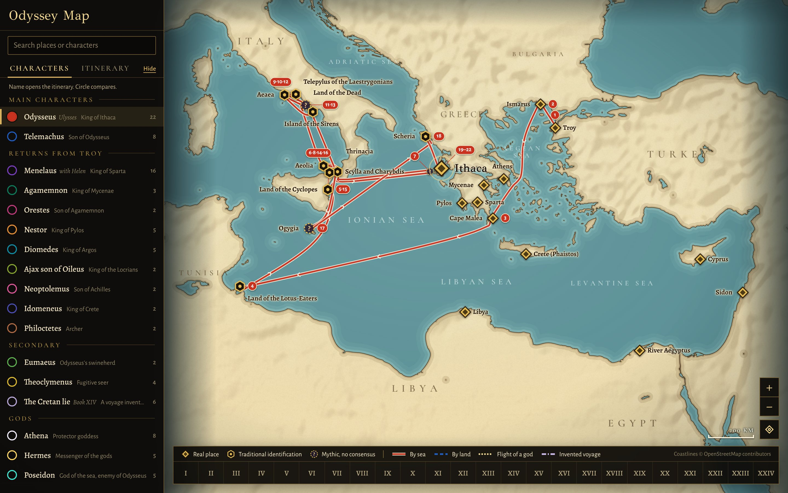
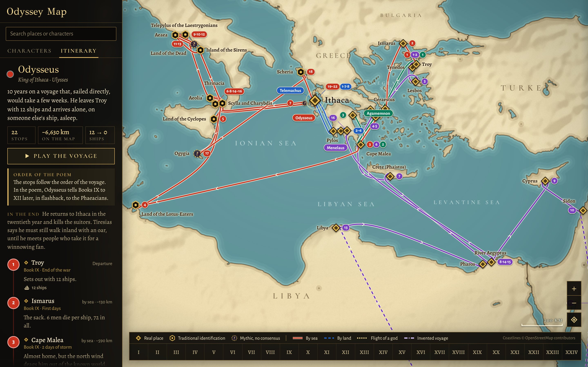
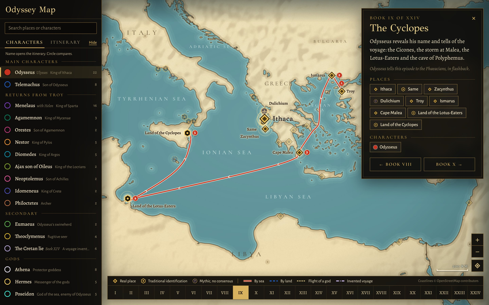
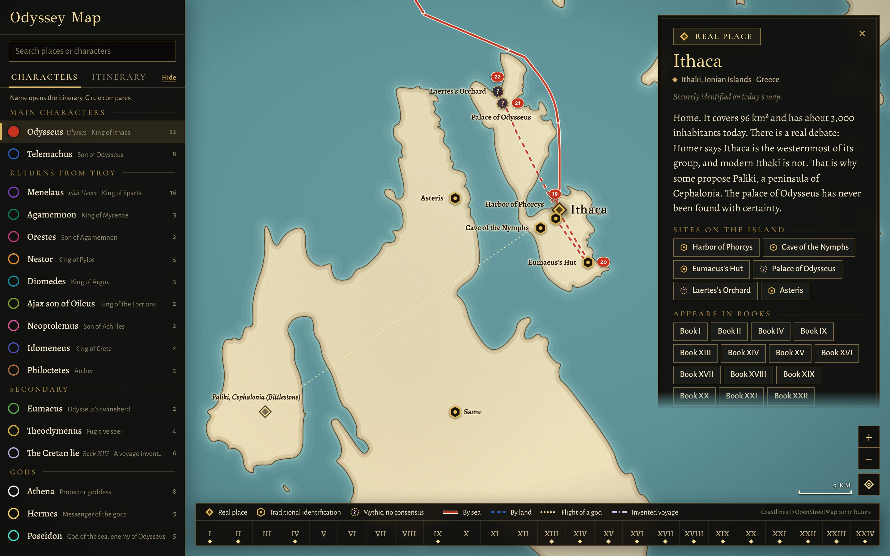
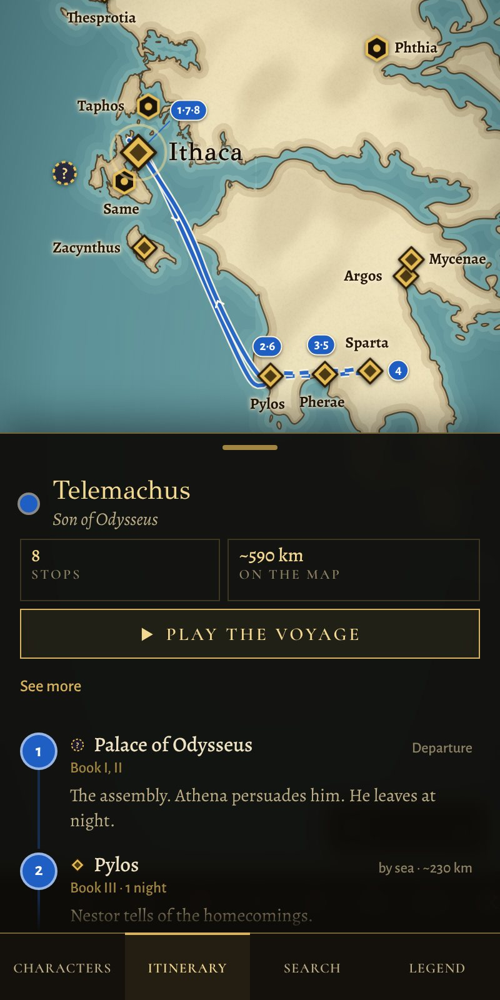

# Odyssey

An interactive map of Homer's *Odyssey* drawn over the real Mediterranean. It shows where each character travels, Book by Book, and how sure we can be about each place.



Open `build/index.html` in a browser. It is one self-contained file and needs no server or network.

## What it does

- **17 routes**: Odysseus, Telemachus, Menelaus, Agamemnon, the other Greeks returning from Troy, Eumaeus, Theoclymenus, the gods, and the invented voyage of the Cretan lie.
- **57 places**, with their Homeric name, modern name and country.
- **Books I to XXIV**: pick a Book to see its summary, places and characters.
- **Playback**: animate a voyage stop by stop, with a ship counter for Odysseus.
- **Compare**: show several routes at once.
- **Search**, zoom and drag, with a close-up of the sites on Ithaca. Works on phones.

## Screenshots

**Compare routes.** Odysseus, Telemachus, Menelaus and Agamemnon on one map.



**Follow the book.** Pick a Book to see where it takes place. Here, Book IX.



**Zoom in on Ithaca.** The sites on the island, with Paliki shown as an alternative location.



**On a phone.** The panels become a bottom drawer. Here, the route of Telemachus.



## How to read the map

Homer gives no coordinates, so many positions are proposals. Each pin shows how firm its location is:

| Pin | Meaning |
|---|---|
| Diamond | Real place, securely identified |
| Hexagon | Traditional identification, accepted by many and disputed by others |
| Dashed circle with "?" | Mythic, no consensus |

Selecting a place also shows other proposed locations when they exist.

Sea routes are computed to avoid land, so paths and distances are approximate and do not come from the poem. The order of Menelaus's stops between Egypt and Pharos is a reconstruction, as the map notes.

## Project layout

| Path | Contents |
|---|---|
| `src/app.html` | The page: HTML, CSS and JavaScript |
| `src/data.json` | Places, characters, stops and Book summaries |
| `src/world.json` | Coastlines, computed routes and relief |
| `src/fonts.json` | Fonts embedded at build time |
| `build/geo.py` | Clips the coastline to the Mediterranean |
| `build/routes.py` | Computes sea routes and writes `src/world.json` |
| `build/bundle.py` | Combines everything into `build/index.html` |
| `tools/shot.js` | Takes screenshots with Playwright |
| `docs/screenshots/` | Images used in this README |
| `BRIEF.md`, `design/` | The original brief and the design reviews |

## Rebuilding

After editing `src/app.html` or `src/data.json`:

```sh
cd geo && npm install && cd ..
python3 build/bundle.py
```

If you change stops or coordinates, regenerate the routes first. This also needs `shapely`, `numpy`, `pillow`, `scipy` and `scikit-image`:

```sh
python3 build/geo.py
python3 build/routes.py
python3 build/bundle.py
```

## Data sources

- Coastlines: [geo-maps](https://github.com/simonepri/geo-maps) `earth-lands-10m`, derived from OpenStreetMap. © OpenStreetMap contributors, [ODbL](https://opendatacommons.org/licenses/odbl/1.0/)
- Relief: the topology image from [three-globe](https://github.com/vasturiano/three-globe)
- Fonts: GFS Didot, Cormorant SC, Alegreya and Alegreya Sans, via [Fontsource](https://fontsource.org)

The places, routes and summaries were written from knowledge of the poem and were not checked line by line against an edition.
